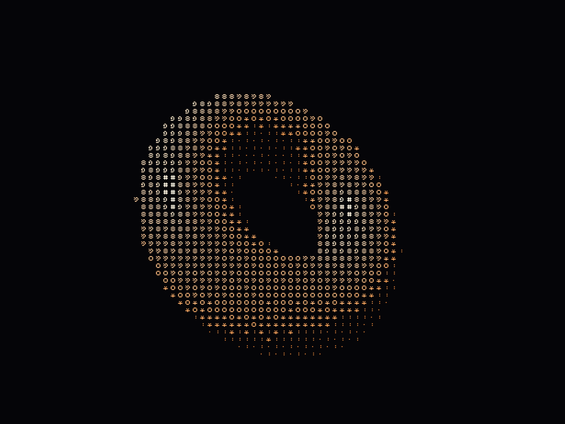
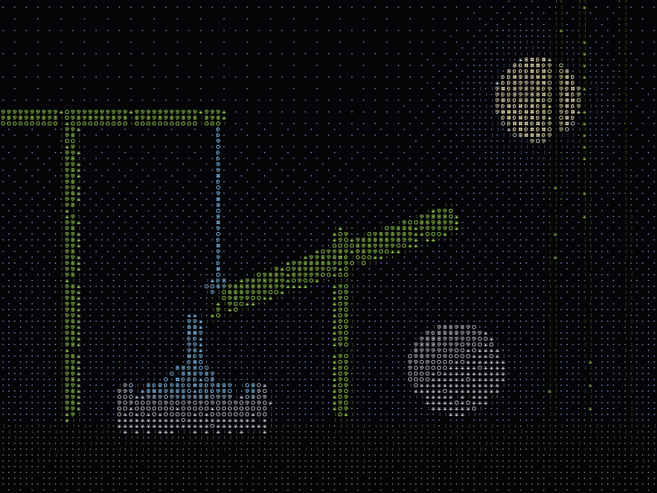

# Creative++

A small creative-coding sketchbook in C++ and OpenGL. Each sketch is a single
fragment shader drawn over the whole window, reloaded the moment you save it.
The host program feeds shaders the time, the mouse, a live webcam, a few
seconds of past webcam frames, and a physics ball.

Most of the sketches here render through an ASCII dither: the picture is cut
into character cells, and each cell's brightness picks a glyph from the ramp
`. : * o & 8 @ #`, with a Bayer pattern blending the steps between them.

| | |
| --- | --- |
|  |  |
| `shaders/donut.frag` | `shaders/bamboo.frag` |

## Requirements

- macOS (Apple silicon or Intel)
- Xcode Command Line Tools, for `clang++` and `make`: `xcode-select --install`

Nothing else needs installing. GLFW is vendored as a prebuilt static library,
and macOS supplies OpenGL itself.

## Run

```sh
make run
```

That builds the program and opens the default sketch, `shaders/ball.frag`.
To open a different one:

```sh
make run SKETCH=shaders/donut.frag
```

Run from the project root so shader paths resolve.

| Key | Action |
| --- | --- |
| `Esc` | quit |
| `Space` | drop a new ball (ball sketch) |

## Sketches

| Sketch | Camera | What it does |
| --- | --- | --- |
| `shaders/ball.frag` | yes | Your webcam as ASCII, plus a red ball that bounces off the bright cells (drawn in white). Pinch the ball between bright areas, or against an edge, and it flattens, then pops into shards; a new one drops in from the top. |
| `shaders/timewarp.frag` | yes | Your webcam as ASCII, with each character row delayed by its distance from the top. The top row is live and the bottom is about 2.5 seconds behind, so movement smears down the screen. |
| `shaders/bamboo.frag` | no | A shishi-odoshi, the bamboo garden fountain: the tube fills from a spout, tips, pours into a stone basin, swings back and clacks on a rock. |
| `shaders/donut.frag` | no | A raymarched spinning donut. |
| `shaders/rings.frag` | no | An animated ring pattern with a glow that follows the cursor. Not dithered. |

### Camera access

The webcam is switched on only while the open sketch uses it. The first time,
macOS asks for camera access for your terminal app. If you denied it, allow it
under System Settings > Privacy & Security > Camera. Frames stay in memory and
are never saved or sent anywhere.

## Writing a sketch

Copy any file in `shaders/`, change it, and open it with `make run SKETCH=...`.
The shader hot-reloads on save. If it fails to compile, the error is printed to
the terminal and the last working version keeps running.

A sketch is a GLSL 4.10 fragment shader that writes one `out vec4`. Declare
whichever of these uniforms you need; the host fills them in:

| Uniform | Type | Meaning |
| --- | --- | --- |
| `uResolution` | `vec2` | framebuffer size in pixels |
| `uTime` | `float` | seconds since start |
| `uMouse` | `vec2` | cursor in pixels, origin bottom-left |
| `uCamera` | `sampler2D` | live camera frame, top row first |
| `uCameraSize` | `vec2` | camera frame size in pixels |
| `uHistory` | `sampler2DArray` | recent camera frames, one per layer, shrunk to about 320 px wide |
| `uHistoryHead` | `int` | layer holding the newest frame; older frames sit at lower layers, wrapping around |
| `uHistoryCount` | `int` | layers that hold a real frame so far |
| `uHistoryLayers` | `int` | total layers (128, about 4 seconds at 30 fps) |
| `uBall` | `vec3` | ball centre in pixels (xy) and radius (z); radius 0 means no ball |
| `uBallSquish` | `vec3` | axis the ball is flattened along (xy) and by how much, 0 to 1 (z) |
| `uShards` | `vec3[32]` | pieces of a popped ball: position (xy) and remaining life, 1 to 0 (z) |
| `uShardCount` | `int` | number of live shards |
| `uShardSize` | `float` | shard radius in pixels |
| `uSolid` | `float` | camera brightness that counts as solid to the ball |

Using a uniform is what turns its feature on: the camera starts when a shader
uses `uCamera` or `uHistory`, and the ball is simulated when a shader uses
`uBall`.

Constants at the top of each shader (`ROWS`, `CONTRAST`, `TINT`, `MAX_DELAY`,
`CYCLE`) apply on save. The ball's physics constants are at the top of
`src/ball.h` and take effect on the next `make run`.

## Layout

```
src/main.cpp      window, render loop, shader loading and hot reload
src/camera.mm     webcam capture through AVFoundation
src/history.cpp   ring of past camera frames in a texture array
src/ball.cpp      ball physics: bouncing, squishing, popping, shards
shaders/          the sketches
docs/             README images
vendor/glfw/      GLFW 3.4 headers and universal static library
Info.plist        embedded in the binary; carries the camera usage description
Makefile          builds everything under src/ into build/sketch
```

Any `.cpp` or `.mm` file added under `src/` is picked up by the Makefile.

## Limits

- macOS only: the build links Apple frameworks and uses the system OpenGL headers.
- OpenGL 4.1 core is the newest version macOS offers, so no compute shaders or
  other 4.3+ features.

## Credits

- [GLFW](https://www.glfw.org) 3.4 for the window and input, under the zlib
  licence (see `vendor/glfw/LICENSE.md`).
- The 5x5 bitmap glyph encoding follows the well-known Shadertoy ASCII-art
  technique by movAX13h.
